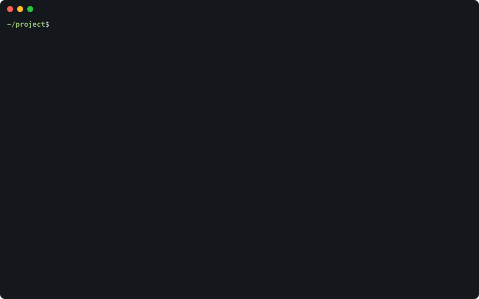

# beekeep

Lead a team of Claude Code agents from your terminal. A queen plans, workers do the work, you watch every step live, and everything that needs your yes waits in one place.



*A real session, recorded with [`scripts/record-demo.ts`](scripts/record-demo.ts). Only the long waits are cut.*

## Why

One Claude Code session is easy to follow. Five are not: they ask for permission in five places, you lose track of who is doing what, and each one starts by loading every tool, plugin and server you have.

beekeep puts them on one screen:

- **Every action, live.** Each bee (agent) shows what it reads, edits and runs as it happens. Show up to three side by side.
- **One place for yes and no.** A bee that wants to run a command, open a web page or touch a file outside its folder waits in a single list. Answer with `y`, `n`, or `a` for "always" where that is safe.
- **A queen who plans.** Give the queen a goal. She splits it into tasks for the workers, with their order and the files each one owns, and nothing starts until you press `y`. She checks the results and reports back.
- **Light bees.** A bee gets only the tools you give it. A read-only bee starts with a few thousand tokens of context, not everything your Claude Code setup loads.
- **Your login, never touched.** beekeep runs the Claude Code you already installed and logged into. It never sees, stores or asks for credentials.

## Install

You need [Claude Code](https://code.claude.com/docs/en/overview), installed and logged in (run `claude` once), and Node 22 or newer.

```sh
npm install -g beekeep
beekeep
```

From source:

```sh
git clone https://github.com/ASRIDK/beekeep && cd beekeep
npm install
bin/beekeep        # Node 24 or newer runs the TypeScript directly
```

macOS and Linux. Two features need macOS for now: giving a bee its own git copy, and git status in the window's sidebar, because beekeep runs git inside a macOS sandbox there. On Linux, a bee with the shell turned on needs Claude Code's sandbox, which uses bubblewrap.

## Use

Run `beekeep`. The first time, press Enter for a starter hive: a queen on Sonnet and two workers on Haiku, working in `~/beekeep-work`.

| Key | What it does |
| --- | --- |
| `↑` `↓` | choose a bee |
| `Enter` | give the chosen bee an order. Start it with `!` to stop what the bee is doing and do this now. `Tab` asks for a plan first |
| `Space` | pin the chosen bee so it stays on screen beside the next one (up to 3) |
| `y` `n` `a` | answer what a bee asks: yes, no, always |
| `Tab` | next question, when several bees ask |
| `p` | see the queen's plan: `y` start it, `u` start it and let its bees edit files, `n` refuse |
| `+` | add a bee: name, job (worker or queen), model, what it may do, shell or not |
| `s` / `x` | stop the chosen bee / stop every bee |
| `w` | open the full window in your browser |
| `q` | leave the screen. Bees keep working; `beekeep stop` ends them |

The bees run in a small local server, so closing the screen or the terminal stops nothing. Run `beekeep` again to come back to where they are.

### More than the terminal

`beekeep window` opens a fuller view in your browser: split panes you can drag, real terminals, Claude Code panes that report to the hive, a map of who talks to whom, a board, rules ("every morning, give this order"), and a usage page. On macOS, `beekeep app` builds a small native app for it.

Everything is also scriptable:

```sh
beekeep bees                       # who is there, and what they are doing
beekeep order "Worker 1" "Run the tests and fix what fails"
beekeep plans                      # the queen's plans and their tasks
beekeep mcp                        # an MCP server, so another Claude Code session can task your bees
```

The command line and MCP can give orders and read everything, but they can never approve a request, change a bee, or start a plan. Only you can, from the screen or the window.

## Your Claude login and usage

beekeep starts bees through Anthropic's [Claude Agent SDK](https://code.claude.com/docs/en/agent-sdk/overview), which runs your installed `claude`. Each bee uses whatever Claude Code is logged into, and its usage counts against your own account. On Claude subscription plans, Agent SDK usage draws from its own monthly credit; see Anthropic's documentation for the current rules.

- beekeep never handles a login. Anthropic does not allow apps to offer Claude.ai login or to share one person's plan with others ([legal and compliance](https://code.claude.com/docs/en/legal-and-compliance)). Use beekeep with your own login, for yourself.
- API keys and cloud providers (`ANTHROPIC_API_KEY`, Bedrock, Vertex) are ignored unless you start beekeep with `BEEKEEP_API_KEY=1`, so a key that happens to be set never bills you by surprise.
- With [quota-axi](https://github.com/kunchenguid/quota-axi) installed, beekeep shows how much of your plan's limits is left and holds new work back below limits you choose.

## Safety

Bees read web pages and files that may try to steer them. beekeep assumes that, and keeps you in charge:

- **What a bee may do is yours to set.** Look (read and search), Work (also edit inside its folder), or Full (all of Claude Code's tools). Background work, schedules and cloud sessions are left out, so nothing runs out of sight.
- **Shell commands are off for new bees.** When on, each command asks you first and runs in a sandbox that can change only the bee's folder, cannot read your keys or beekeep's own data, and reaches the internet only after its own yes.
- **"Always" is narrow.** It covers one exact command, one website or one tool. Never file access, and never an address that could be read two ways.
- **Orders never widen permissions.** A queen's task gives a worker nothing it did not already have. Plans have limits on orders, wake-ups and time.
- **Own git copies (macOS).** A bee can work in a full, separate copy of your repository. Its commits come back as a branch only when you ask; nothing it does can touch your repository.
- **Local only.** The server listens on 127.0.0.1 behind a secret. Other websites in your browser cannot reach it, and the screen strips terminal control codes from anything a bee or page produces.

## Settings

| Variable | Default | |
| --- | --- | --- |
| `BEEKEEP_WORK` | `~/beekeep-work` | where new bees work |
| `BEEKEEP_HOME` | `~/.beekeep` | beekeep's own data |
| `BEEKEEP_PORT` | `3150` | the local server's port |
| `BEEKEEP_API_KEY` | off | `1` lets bees use an API key or cloud provider |

## Develop

```sh
npm test                               # unit and integration tests, no Claude needed
node scripts/screen-check.ts           # drives the terminal screen in a hidden terminal
LIVE=1 node scripts/screen-check.ts    # the same with real Claude (uses a little of your usage)
```

The server is in `server/`, the terminal screen in `tui/`, the browser window in `web/`.

## License

MIT. beekeep is an independent project, not made or endorsed by Anthropic.
